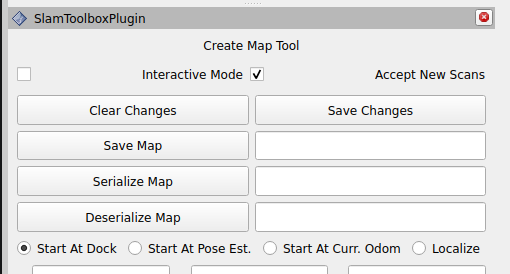
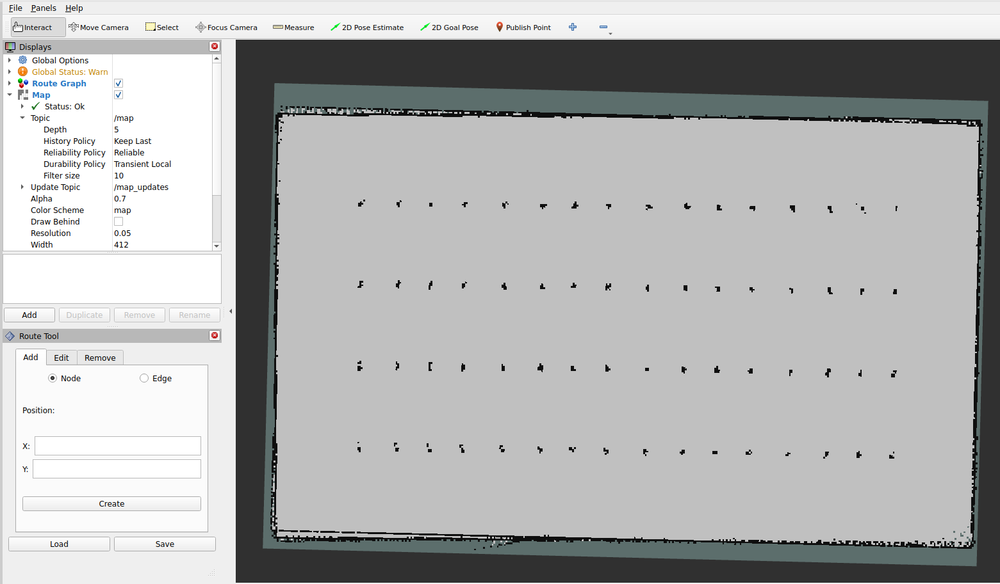
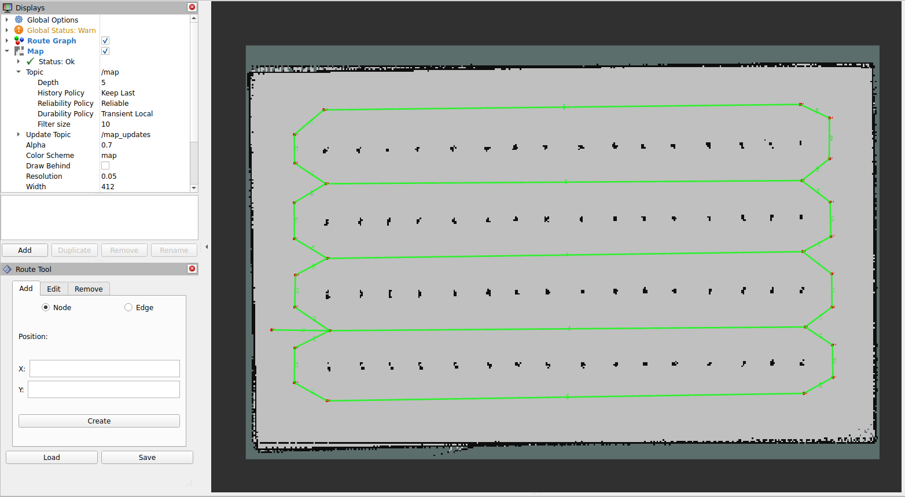
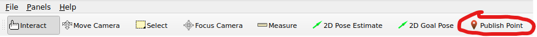
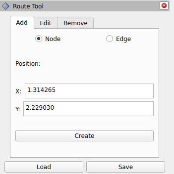
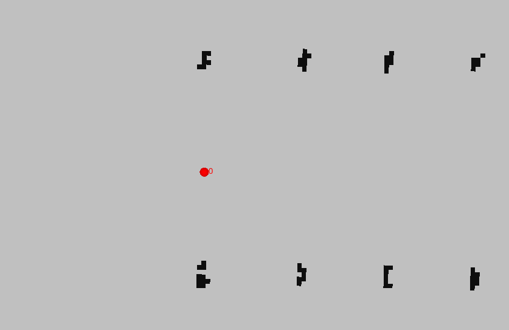
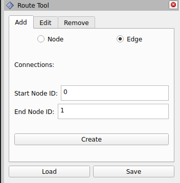
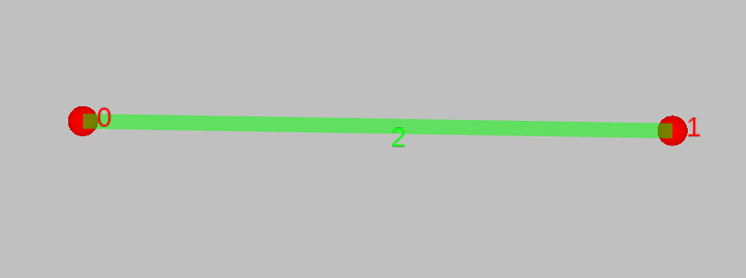
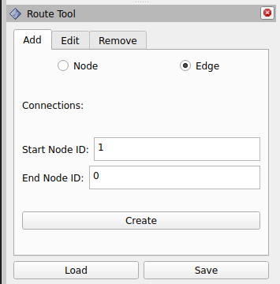
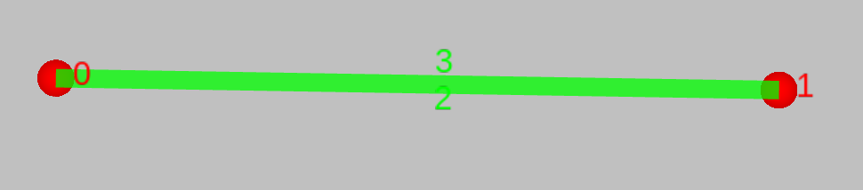

# AGV Autonomous Navigation System

This repository contains the source code for the AGV Autonomous Navigation System developed using ROS 2 Jazzy.

> **Note:** This guide assumes the ROS 2 workspace is located at `~/ros2_ws`.

## Prerequisites

Before building the project, ensure the following software is installed:

- Ubuntu 24.04 LTS
- ROS 2 Jazzy
- Colcon
- Git

Verify your ROS 2 installation:

```bash
source /opt/ros/jazzy/setup.bash
ros2 --version
```

---

# Workspace Setup

This repository is intended to be used as the root of a ROS 2 workspace.

Create the workspace directory:

```bash
mkdir -p ~/ros2_ws
```

Clone the repository directly into the workspace:

```bash
git clone <repository-url> ~/ros2_ws
```

Navigate to the workspace:

```bash
cd ~/ros2_ws
```

Your workspace structure should look similar to:

```text
ros2_ws/
├── README.md
└── src/
    ├── lidar_sensor/
    └── orlar_agv/
```

After building the workspace, the following directories will be generated automatically:

```text
ros2_ws/
├── build/
├── install/
├── log/
├── README.md
└── src/
```

Build the workspace:

```bash
source /opt/ros/jazzy/setup.bash

colcon build --symlink-install
```

Source the workspace:

```bash
source install/setup.bash
```
---

# Environment Setup

Every new terminal session requires sourcing ROS 2 and the workspace.

Source ROS 2 Jazzy:

```bash
source /opt/ros/jazzy/setup.bash
```

Source the workspace:

```bash
source ~/ros2_ws/install/setup.bash
```

Alternatively, add these commands to your `.bashrc`:

```bash
echo "source /opt/ros/jazzy/setup.bash" >> ~/.bashrc
echo "source ~/ros2_ws/install/setup.bash" >> ~/.bashrc
source ~/.bashrc
```
---

# Build Instructions

Ensure all Python nodes across all packages have execution permissions:

```bash
find src/ -type f -name "*.py" -exec chmod +x {} +
```

Navigate to the workspace root:

```bash
cd ~/ros2_ws
```

Source ROS 2 Jazzy:

```bash
source /opt/ros/jazzy/setup.bash
```

Build all packages:

```bash
colcon build --symlink-install
```

If the build completes successfully, source the workspace:

```bash
source install/setup.bash
```
---
# Running the AGV Simulation

Before launching the simulation, ensure the Gazebo model path is exported so Gazebo can locate the custom world models:

```bash
export GZ_SIM_RESOURCE_PATH=$GZ_SIM_RESOURCE_PATH:$HOME/ros2_ws/src/orlar_agv/models
```

Launch the AGV simulation:

```bash
ros2 launch orlar_agv launch_sim.launch.py
```

This launch file starts:

- Gazebo Sim (GZ Sim)
- Robot State Publisher
- ROS 2 Control Controllers
- ROS-Gazebo Bridge
- Joystick Interface
- Twist Multiplexer
- AGV Robot Model
## Teleoperation

To manually control the AGV using the keyboard, open a new terminal and source the workspace:


Run the teleoperation node:

```bash
ros2 run teleop_twist_keyboard teleop_twist_keyboard
```

### Controls

```text
u    i    o
j    k    l
m    ,    .
```

- `i` : Move forward
- `,` : Move backward
- `j` : Turn left
- `l` : Turn right
- `k` : Stop

## Changing the Simulation World (Optional)

The simulation world loaded by Gazebo is configured in:

```text
src/orlar_agv/launch/launch_sim.launch.py
```

Locate the following section:

```python
default_world = os.path.join(
    get_package_share_directory(package_name),
    'worlds',
    'orlar_table_world.sdf'
)
```

Replace `orlar_table_world.sdf` with another world file located in the `worlds` directory.

Example:

```python
default_world = os.path.join(
    get_package_share_directory(package_name),
    'worlds',
    'greenhouse_world.sdf'
)
```

After changing the world, rebuild the workspace:

```bash
cd ~/ros2_ws

colcon build --symlink-install

source install/setup.bash
```

Then relaunch the simulation:

```bash
ros2 launch orlar_agv launch_sim.launch.py
```
---
# Slam_tool_box

### Option 1: All-in-One Quick Run (Unified Launch)

If you want to spin up Gazebo, SLAM, and your custom RViz setup simultaneously without opening multiple terminals, use this single command:
```bash
ros2 launch orlar_agv orlar_mapping.launch.py
```

### Option 2: 

To use the slam_tool_box, run the simulation like the previous section then use this command to enable the slam
```bash
ros2 launch slam_toolbox online_async_launch.py params_file:=./src/orlar_agv/config/mapper_params_online_async.yaml use_sim_time:=true
```
To change any setting for the slam_tool_box please modidy the `mapper_params_online_async.yaml` inside the `config` folder

To show it in rviz2 use this command
```bash
ros2 run rviz2 rviz2 -d src/orlar_agv/config/slam_mapping.rviz 
```

### Save map
To save the map please input these location accordingly in the slam pannel

`Save map:` ./src/orlar_agv/maps/orlar_farm_house_map

`Serialize map:` ./src/orlar_agv/maps/orlar_farm_house_serial



# Creating a Route with RViz

The AGV moves only along predefined paths, using the route server to search for and navigate a route. To create a route, use the `Nav2 Route Tool`, replacing the file path with the path to the map saved in the previous section:

```bash
ros2 launch nav2_rviz_plugins route_tool.launch.py yaml_filename:=/path/to/map.yaml
```

After launching, you should see the RViz window below:



The route server uses graph-based navigation, made up of nodes and edges. To create a path, you need at least two nodes and one edge connecting them. Each edge is directional, so to create a bidirectional path, you need to add a second edge in the opposite direction. For example, given two nodes A and B, the first edge would be A → B, and the second edge would be B → A.

## Loading an Existing Path

To load an existing path, open the `Route Tool` panel, click `Load`, then select a path file with the `.geojson` extension. For example:



## Creating a Node

Click the `Publish Point` button on the top navigation bar:



Click on the position where you want to create a node. The `Route Tool` panel will appear in the bottom left — make sure it shows `Add`, `Node`, then click `Create`:



The new point will appear in RViz along with its ID:



## Creating an Edge

Create a second node using the same steps above. Next, add an edge to form a path for the route server. In the `Route Tool` panel, switch to `Add`, `Edge`, then enter the direction of the edge:



The new edge will appear in green, along with its ID:



To create a bidirectional path, repeat the same steps in reverse order:



You now have a bidirectional pathway formed by two edges in opposite directions:



## Editing or Removing Nodes and Edges

To `Edit` or `Remove` a node or edge, switch to the corresponding tab in the `Route Tool` panel and enter the ID of the node or edge you want to change. Then enter the new position (for a node) or new direction (for an edge).

# Setup for Route Follow Mission

After creating a pathway for the AGV, it needs to know how to navigate along that path. To do this, we use another `mission_route.yaml` file (located in `paths folder`) to tell the `route_follow` node what to do. Here's an example of what it should look like:

```yaml
home:
  node_id: 0

inspection_points:
- id: table_1
  start_id: 0
  end_id: 1
  camera: "on"
- id: move_to_table_2
  start_id: 1
  end_id: 3
  camera: "off"
- id: table_2
  start_id: 3
  end_id: 4
  camera: "on"
- id: move_to_table_3
  start_id: 4
  end_id: 6
  camera: "off"
- id: table_3
  start_id: 6
  end_id: 7
  camera: "on"
```

## `home`

```yaml
home:
  node_id: 0
```

The `home` field contains the ID of the AGV's starting node. This should be the AGV's home position — the start and end point of the entire operation in the farmhouse.

## `inspection_points`

The `inspection_points` field defines the navigation tasks that tell the AGV how to navigate and what actions to perform along the way:

```yaml
inspection_points:
- id: the ID of the table the AGV will capture at when moving along this path, or just a note (e.g. "move_to_table_1") when it's not capturing
  start_id: the starting position, or the AGV's current position
  end_id: the end position of the navigation task
  camera: the camera state, "on" or "off" (turn "off" when switching halls)
```

# Navigation with Nav2

To run the navigation stack:

```bash
ros2 launch agv_mission nav2_sim.launch.py 
```


Before running the mission node, start the image capture service:

```bash
ros2 launch camera interval_image_capture.launch.py
```

Expected output:

```text
Image capture service ready.
Subscribed to : /top_camera/image_raw
Service       : /top_camera/take_picture (std_srvs/Trigger)
Save directory: pics/orlar_table
```

Optionally, monitor the camera stream:

```bash
ros2 run rqt_image_view rqt_image_view
```

Then select:

```text
/top_camera/image_raw
```

from the topic list.


## Camera Service Configuration

The image capture service supports several launch parameters.

Default configuration:

| Parameter       | Default Value         |
| --------------- | --------------------- |
| image_topic     | /top_camera/image_raw |
| save_dir        | pics/orlar_table      |
| image_format    | png                   |
| filename_prefix | table_capture         |

### Change Save Directory

```bash
ros2 launch camera image_capture.launch.py \
    save_dir:=/home/user/table_pictures
```

### Change Image Format

```bash
ros2 launch camera image_capture.launch.py \
    image_format:=jpg
```

Supported formats:
* png
* jpg

### Change Camera Topic

```bash
ros2 launch camera image_capture.launch.py \
    image_topic:=/camera/image_raw
```

### Example With Multiple Parameters

```bash
ros2 launch camera image_capture.launch.py \
    save_dir:=/home/user/table_pictures \
    image_format:=jpg \
    filename_prefix:=inspection
```

# Robot Model Visualization

Launch the robot model visualization environment:

```bash
ros2 launch orlar_agv view_robot_joint_state_gui.launch.py
```

This launch file starts:

- Robot State Publisher
- RViz2 with the provided configuration
- Joint State Publisher GUI

The AGV model will appear in RViz2 and can be manipulated using the Joint State Publisher GUI.

---
# WSL2 USB Device Setup (LiDAR)

If you are running ROS 2 inside WSL2 and the LiDAR is connected to your Windows machine, you must attach the USB device to WSL before launching the driver.

## Install USBIPD

On Windows, install USBIPD if it is not already available:

```powershell
winget install dorssel.usbipd-win
```

Verify the installation:

```powershell
usbipd --version
```

---

## List Connected USB Devices

Open PowerShell as Administrator and run:

```powershell
usbipd list
```

Example output:

```text
BUSID  VID:PID    DEVICE
2-4    10c4:ea60 Silicon Labs CP210x USB to UART Bridge
```

Locate the LiDAR device and note its BUSID.

---

## Share the Device

Run the following command in PowerShell as Administrator:

```powershell
usbipd bind --busid <BUSID>
```

Example:

```powershell
usbipd bind --busid 2-4
```

This only needs to be done once for a device.

---

## Attach the Device to WSL2

Attach the LiDAR to your ROS environment:

```powershell
usbipd attach --wsl --busid <BUSID>
```

Example:

```powershell
usbipd attach --wsl --busid 2-4
```

---

## Verify the Device in WSL

Inside Ubuntu/WSL:

```bash
ls /dev/ttyUSB*
```

Expected output:

```text
/dev/ttyUSB0
```

You can also verify with:

```bash
dmesg | tail
```

or

```bash
lsusb
```

---

## Configure Serial Port Permissions

If access is denied:

```bash
sudo chmod 666 /dev/ttyUSB0
```

Or add your user to the dialout group:

```bash
sudo usermod -a -G dialout $USER
```

Log out and reopen the terminal afterwards.

---

# Running the RPLiDAR

Source ROS 2:

```bash
source /opt/ros/jazzy/setup.bash
```

Source the workspace:

```bash
source ~/ros2_ws/install/setup.bash
```

Launch the LiDAR driver:

```bash
ros2 launch rplidar_ros rplidar.launch.py
```

# Use full Command

Run Rviz2 with config
```bash
ros2 run rviz2 rviz2 -d /path/to/your_config.rviz
```

If the pkg build fail but the error is not inside the file, try remove the build, log and install folder then rebuild
```bash
cd ~/ros2_ws
rm -rf build/ log/ install/
colcon build --symlink-install
```

Make the wsl render using GPU instead of IGPU, you can add into the `./bashrc` instruction to make it enable for every section.

Replace NVIDIA with AMD if your using AMD
```bash
export GALLIUM_DRIVER=d3d12
export MESA_D3D12_DEFAULT_ADAPTER_NAME=NVIDIA
export LIBGL_ALWAYS_SOFTWARE=0
```